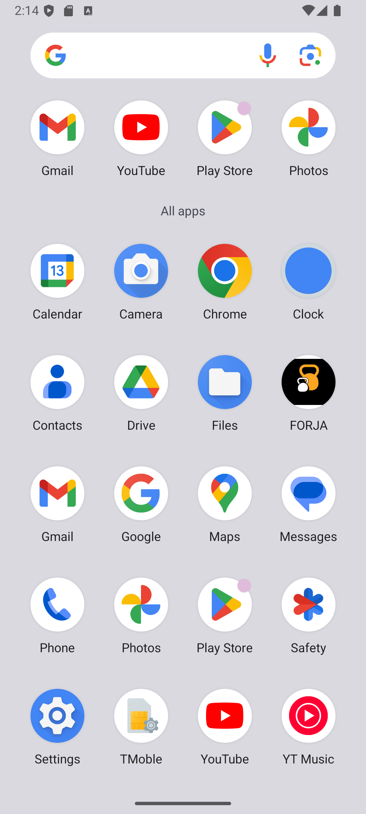
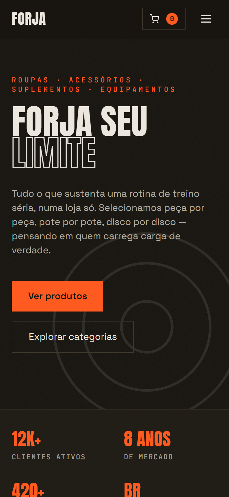

# FORJA — Loja de artigos para treino

Aplicativo mobile da FORJA, uma loja de roupas, acessórios, suplementos e equipamentos para academia. O projeto combina uma interface React responsiva com Capacitor para distribuição Android.

## Identidade visual

O ícone usa como referência duas kettlebells sobre fundo preto. A tela de abertura acompanha a mesma identidade e apresenta a marca FORJA.

| Ícone do aplicativo | Tela de abertura |
|:--:|:--:|
|  |  |

## Aplicativo em execução

Captura da grade de aplicativos no emulador Android `Medium_Phone_API_36.0`, com o ícone FORJA instalado:



Prévia responsiva da tela inicial:



## Recursos

- Catálogo organizado em roupas, acessórios, suplementos e equipamentos.
- Busca e filtro por categoria, carrinho e fluxo de checkout.
- Autenticação e dados de produtos integrados ao Supabase.
- Operações administrativas de cadastro e edição de produtos.
- Acesso à câmera/galeria e notificações locais no Android.

## Tecnologias

- React 19 e Vite 8.
- Capacitor 8 e Android.
- Supabase JS para autenticação e dados.
- `@capacitor/assets` para gerar ícones e telas de abertura Android.

## Executar localmente

Requisitos: Node.js 22 ou superior, npm e Android Studio com Android SDK para compilar/abrir a versão nativa.

```bash
npm ci
npm run dev
```

Configure as variáveis do Supabase em `.env.local` (não publique chaves privadas):

```env
VITE_SUPABASE_URL=https://seu-projeto.supabase.co
VITE_SUPABASE_ANON_KEY=sua-chave-publica-anon
```

## Gerar e sincronizar os recursos Android

```bash
node scripts/generate-brand-assets.cjs
npx capacitor-assets generate --android
npm run build
npx cap sync android
```

O ícone-fonte está em `assets/icon.png` (1024 × 1024) e a splash em `assets/splash.png` (2732 × 2732). Os recursos nativos são gerados nas densidades Android necessárias.

## Build Android no GitHub

O workflow [`.github/workflows/android-build.yml`](.github/workflows/android-build.yml) compila a APK em pushes para `main` ou `master` e também pode ser iniciado manualmente pela aba **Actions**. Baixe o artefato **`meu-aplicativo-apk`** na execução correspondente.

Identificador Android: `com.forja.academia`.
